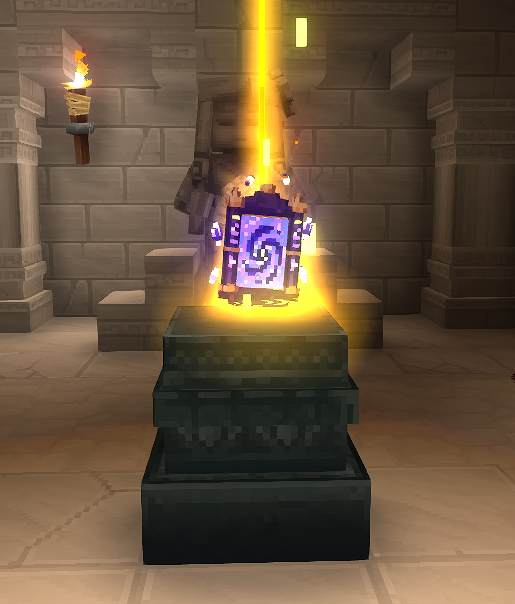
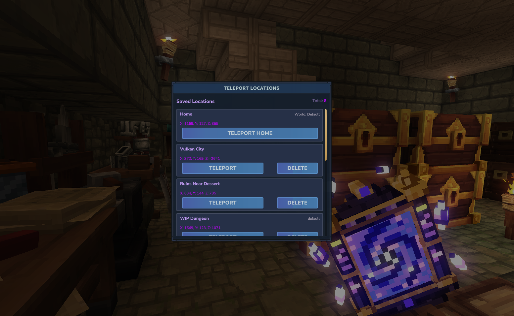
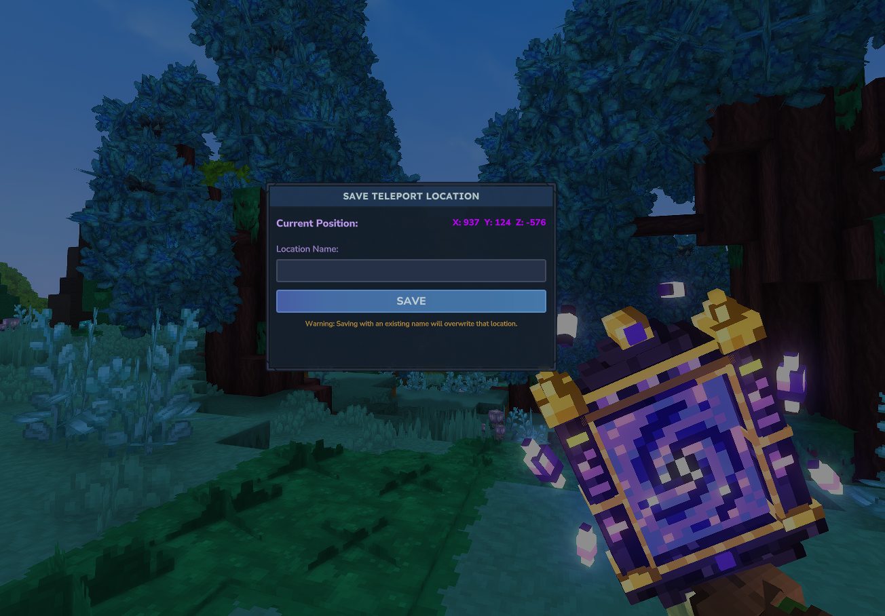
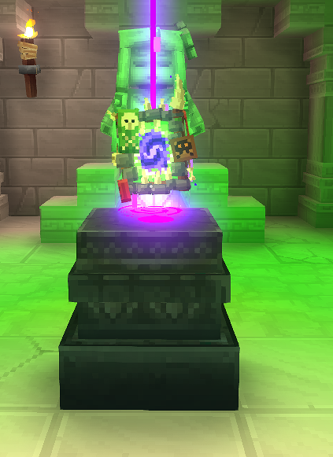

PortalHome adds two craftable portals to Hytale: the Pocket Portal for saving and revisiting your own locations, and the Goblin Portal for travelling to and returning from the Goblin Lab.

## Pocket Portal

Use the Pocket Portal to build a personal list of destinations.

- Hold **Primary Interaction** for 2.5 seconds to open the teleport menu. Choose your world spawn or a saved location, or delete a saved location.

- Hold **Secondary Interaction** for 2.5 seconds to open the save menu and name your current location.

- Saved locations include their world, so you can travel between worlds. The saved world must still exist on the server; the portal loads it if needed.

The portal shows a HUD indicator while held. It has a maximum stack size of one and is kept on death.

### Pocket Portal recipe

Craft at a Goblin Lab workbench:

- 15 Life Essence
- 15 Fire Essence
- 15 Void Essence

Craft time: 3.5 seconds.

## Goblin Portal

The Goblin Portal takes you to the Goblin Lab and gives you a way back to where you entered.

- Hold **Primary Interaction** for 2.5 seconds to enter the Goblin Lab.
- Hold **Secondary Interaction** for 2.5 seconds while in the Goblin Lab to return to your entry point.

The portal shows its own HUD indicator while held. It has a maximum stack size of one and is kept on death.

### Goblin Portal recipe

Craft at a Goblin Lab workbench:

- 30 Scraps
- 15 Void Essence
- 5 Void Crystals

Craft time: 3.5 seconds.

## Using either portal

Do not crouch while charging. Movement slows during the 2.5-second charge, and taking damage cancels the interaction. Each portal has a custom model, animation, and charging effect.
