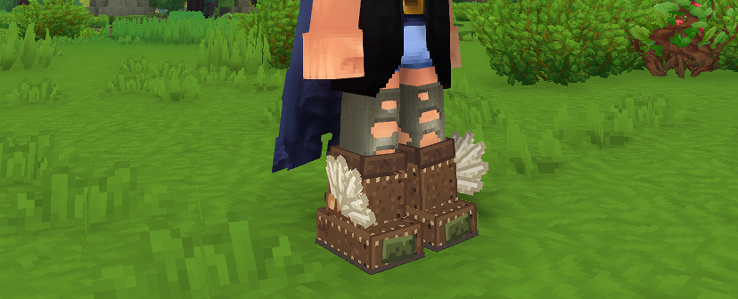
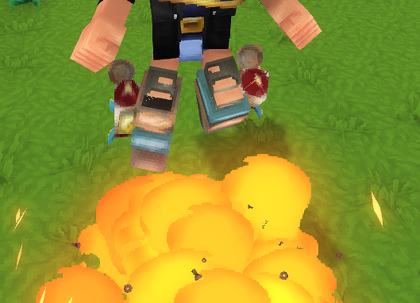
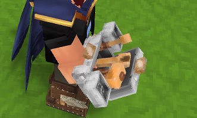
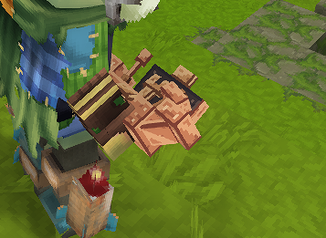

Hawks Quality Improvements is a Hytale asset-pack mod with four craftable items for the Goblin Lab and workbench: two
rocket-boot variants, a rocket-powered glider, and a silver repair kit. The mod targets Hytale server version 0.7.4 and
later.

## Items

| Item                      | Image                                                        | What it does                                                                                                                                                                |
|---------------------------|--------------------------------------------------------------|-----------------------------------------------------------------------------------------------------------------------------------------------------------------------------|
| **Hermes Boots**          |                    | A Rocket Boots variant with 13 added health, 7% physical damage resistance, 7% projectile damage resistance, and full stamina regeneration each second while out of combat. |
| **Improved Rocket Boots** |  | Has the same configured armor stats as Hermes Boots and adds two extra jumps. The item also defines glider movement settings.                                               |
| **Weird Rocket Glider**   |      | A rare glider with a horizontal speed multiplier of 4, speed 10, and terminal velocity 2. Its climb rate and dive-to-energy conversion are set to 0.                        |
| **Silver Repair Kit**     |          | A rare repair kit whose repair interaction has its penalty set to 0.                                                                                                        |
| **Copper Repair Kit**     |          | Consumes one kit to add 50% of the selected item's current maximum durability, capped at full, without reducing maximum durability. Uses the native repair selection UI, with a copper toolbox, wooden tool grips, and rare quality. |

### Crafting recipes

Recipes are defined in the item assets. Crafting times are set to one second and knowledge is not required for the
Goblin Lab recipes.

| Item                  | Ingredients                                                              | Crafting station and requirements                                                                        |
|-----------------------|--------------------------------------------------------------------------|----------------------------------------------------------------------------------------------------------|
| Hermes Boots          | 20 Cindercloth scraps, 20 light leather, 2 red feathers, 20 linen scraps | Goblin Lab Workbench, Goblin Lab Gadgets category, `goblin_lab_power` augment                            |
| Improved Rocket Boots | 30 scraps, 4 gadget assemblies, 2 Bangsticks, 1 Voidtaken Grizzly Hide   | Goblin Lab Workbench, Goblin Lab Gadgets category, `goblin_lab_power` and `goblin_lab_recipe_c` augments |
| Weird Rocket Glider   | 200 scraps, 6 gadget assemblies, 6 spider silk, 6 Bangsticks             | Goblin Lab Workbench, Goblin Lab Gadgets category, `goblin_lab_power` and `goblin_lab_recipe_b` augments |
| Silver Repair Kit     | 2 linen scraps, 5 silver bars, 1 light leather                           | Tier 1 Workbench, Tools category                                                                         |
| Copper Repair Kit     | 2 linen scraps, 5 copper bars, 1 light leather                           | Tier 1 Workbench, Tools category                                                                         |
